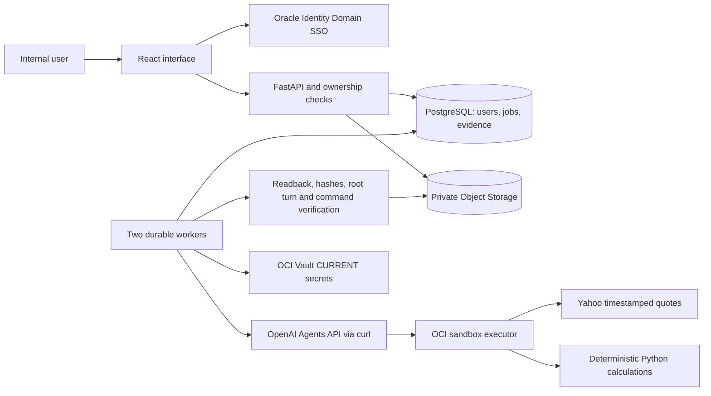

# Portfolio Health & Rebalancing Advisor

Folio is a separate internal demo for the OpenAI **Agents API**, using the repository's existing Bash/curl transport and an OCI Sandbox executor. A presenter uploads fictional US stock/ETF holdings, compares allocation models, and receives a reconciled proposal with downloadable evidence. No trades, tax calculations, or suitability decisions are implemented.

## Run the local rehearsal

Use Python 3.13, Node 22, and Docker. Dependencies, including public OCI SDK 2.189.0, install from the hashed requirements lock. From the repository root:

```bash
python3 portfolio-advisor/scripts/setup.py
docker compose -f portfolio-advisor/deploy/compose.yaml up -d database
portfolio-advisor/.venv/bin/python portfolio-advisor/scripts/run_local.py --rehearsal
```

Open **http://127.0.0.1:8780**. The supervisor runs one API and two workers. PostgreSQL listens only on `127.0.0.1:55439`; its named volume survives restarts. The current development session already has a task-owned PostgreSQL container at that port; do not launch a second one until it is stopped. Rehearsal explicitly uses synthetic prices and a fixture explanation, accepts only the documented sample symbols, and never contacts OpenAI, Yahoo or OCI. This mode is rejected for hosted/public configuration.

Use `examples/holdings.csv` or **Load example portfolio**. The fixture portfolio totals **$86,000**: AAPL $24,000; MSFT $16,000; NVDA $12,000; VTI $20,000; BND $9,000; CASH $5,000. At 60/35/5, the proposal targets VTI $51,600, BND approximately $30,100, and cash approximately $4,300. Exact fractional-share rounding remains in cash.

Stop the supervisor with Ctrl-C. PostgreSQL is independent and stays running until explicitly stopped. Local artifacts reside in `.local/artifacts`; preserve that directory with the database for local rehearsal continuity. In live mode, artifact durability comes from OCI Object Storage.

## Live configuration and credential boundary

The root `.env` is Git-ignored and mode `0600`. All five dedicated Vault references are populated from this rollout, including its database and SSO credentials. Startup intentionally rejects missing or unresolvable references.

| Variable | Dedicated Vault secret |
|---|---|
| OPENAI_API_KEY | portfolio-advisor-openai-api-key |
| OPENAI_EXECUTOR_API_KEY | portfolio-advisor-openai-executor-key |
| AUTH_SESSION_SECRET | portfolio-advisor-session-secret |
| SSO_CLIENT_SECRET | portfolio-advisor-sso-client-secret |
| DATABASE_URL | portfolio-advisor-database-url |

References use `{"secretId":"actual-secret-OCID"}`. Startup loads each `CURRENT` secret into process memory before creating clients or opening the database, rejects identical OpenAI keys, and suppresses provider error bodies. Local live mode uses the `Sandbox` security-token profile. Hosted mode requires resource principals, HTTPS, and a PostgreSQL URL with `sslmode=verify-full`. Do not use RFx credentials or OCI inference keys as OpenAI Agents credentials.

The dedicated Portfolio Advisor agent and a fresh self-hosted **gpt-5.6-luna** session were created on the OpenAI platform. Their project, agent and bootstrap session IDs are configured in the root `.env` and recorded in `deploy/private/openai-resources.json`. The first live analysis claims the prepared session once, after verifying its model, instructions, environment and empty history; subsequent analyses create isolated sessions. The session has no turns and awaits its OCI executor. Platform resource creation does not establish live analysis success.

```bash
portfolio-advisor/.venv/bin/python portfolio-advisor/scripts/check_config.py
portfolio-advisor/.venv/bin/python portfolio-advisor/scripts/check_oci_capabilities.py
# Only after dedicated credentials and network access exist:
portfolio-advisor/.venv/bin/python portfolio-advisor/scripts/check_config.py --resolve-vault
portfolio-advisor/.venv/bin/python portfolio-advisor/scripts/run_local.py
```

Public OCI SDK **2.189.0** provides the required sandbox and hosted-application capabilities. Both hashed Python lockfiles pin this release. `scripts/rollout.py` supplies the journaled lifecycle CLI; Oracle's separate `oci-cli` package is optional and installed independently. Run `scripts/check_oci_capabilities.py` to check SDK capabilities without authenticating or contacting OCI.

## Architecture



Each analysis receives an isolated reusable session. Follow-ups continue that session and cannot execute commands or change inputs/reports. Only the separate executor credential is passed into the sandbox. Sandbox lifetime is 30 minutes; saved reports remain available afterward. Session/question content is processed by OpenAI; quotes and calculation execution occur in OCI. The UI requires processing acknowledgement.

A run succeeds only with one matching successful command from the completed root turn, unchanged helper/input hashes, matching request identity, artifact readback, and a second deterministic calculation. A disconnect, ambiguous write, provider failure, or missing quote never turns into a successful report. Unknown submissions retain journals and require reconciliation; they are not blindly retried.

The application serializes work per user, uses PostgreSQL row and advisory locks for two workers, persists idempotency keys and remote identifiers, and revokes owner access immediately on deletion. Cleanup remains pending/retrying until remote deletion is confirmed. Artifact bucket versioning is disabled so deleting artifacts does not silently retain object versions. Database backups retain deleted records until their seven-day retention expires; see the runbook.

## Interfaces

All `/api/v1` routes require the signed session, enforce ownership, and require CSRF tokens on writes.

| Route | Purpose |
|---|---|
| `GET /api/v1/templates` | Illustrative 30/60/10, 60/35/5 and 80/15/5 models |
| `POST /api/v1/portfolios/preview` | Validate CSV without saving or cloud execution |
| `GET, POST /api/v1/portfolios` | Owner list and validated upload |
| `GET, DELETE /api/v1/portfolios/{id}` | Read or revoke access and queue cleanup |
| `POST /api/v1/portfolios/{id}/analyses` | Durable analysis; UUID Idempotency-Key required |
| `GET /api/v1/portfolios/{id}/runs` | Saved history |
| `GET /api/v1/runs/{id}` | Status and verified result |
| `GET /api/v1/runs/{id}/events` | Owner-scoped progress stream |
| `POST /api/v1/runs/{id}/questions` | Follow-up; UUID Idempotency-Key required |
| `POST /api/v1/runs/{id}/resume` | Reconcile a needs-review run without blind replay |
| `GET /api/v1/runs/{id}/artifacts/{html,csv,json}` | Authenticated report downloads |
| `GET /api/v1/deletions` | Cleanup state after access revocation |

## Validation and delivery

`requirements.lock`, `requirements-dev.lock`, `frontend/package-lock.json`, and `infra/foundation/.terraform.lock.hcl` lock dependencies. The runtime image contains the built UI, API, workers and public OCI SDK, runs as UID 10001, and excludes `.env`, private journals, local holdings, and credentials from build context.

```bash
portfolio-advisor/.venv/bin/python -m pip install --require-hashes --find-links portfolio-advisor/vendor -r portfolio-advisor/requirements-dev.lock
portfolio-advisor/.venv/bin/python -m pytest portfolio-advisor/tests -q
# Set TEST_DATABASE_URL to an isolated LOCAL PostgreSQL database to include the four DB tests.
python3 -m unittest discover -s tests -q
PYTHONPATH=stock-demo:. python3 -m unittest discover -s stock-demo/backend -p 'test_*.py' -q
terraform -chdir=portfolio-advisor/infra/foundation init -backend=false
terraform -chdir=portfolio-advisor/infra/foundation validate
docker build -f portfolio-advisor/deploy/Dockerfile -t portfolio-advisor:reviewed .
```

The OCI hosted application is **ACTIVE**: [Open Portfolio Advisor](https://inference.generativeai.us-chicago-1.oci.oraclecloud.com/20251112/hostedApplications/ocid1.generativeaihostedapplication.oc1.us-chicago-1.amaaaaaafigrwqyacofmt5zjaripoblrh47ydu7shpjoljjlgkmb5enhybta/actions/invoke/) and sign in with Oracle. Verified: deployed image identity, prefixed UI/assets, API/database/worker health, private anonymous-access boundary and a real Oracle sign-in to the dashboard. Tag `source-94a0ba95e06fca31-flat1` resolves to `sha256:d5d59c226fae1ef26e21bccb38b57532a1397581c2aebb0fc49723d80daba435`.

The first live example analysis reached OCI sandbox creation but stopped in Needs Review while its sandbox remained CREATING beyond the startup wait. No completed model report is claimed. The private registry and exact-secret Vault permissions remain in place; temporary publishing grants are removed. The separately approved ALLOW_ALL sandbox policy remains active.

See [verification and remaining acceptance](docs/VERIFICATION.md), [presenter walkthrough](docs/PRESENTER.md), [operations](docs/RUNBOOK.md), [authorized rollout review](docs/ROLLOUT_REVIEW.md), [hosted deployment](docs/HOSTED_DEPLOYMENT.md), and [verified image repackaging](docs/IMAGE_REPACKAGE.md).

## User access administration

Oracle sign-in requires an enabled application account. Administrators use **Manage access** to grant named users access, assign Member or Administrator roles, disable sessions, and review changes. Portfolio ownership remains private even from administrators. See [the administrator guide](docs/ACCESS_ADMIN.md).
